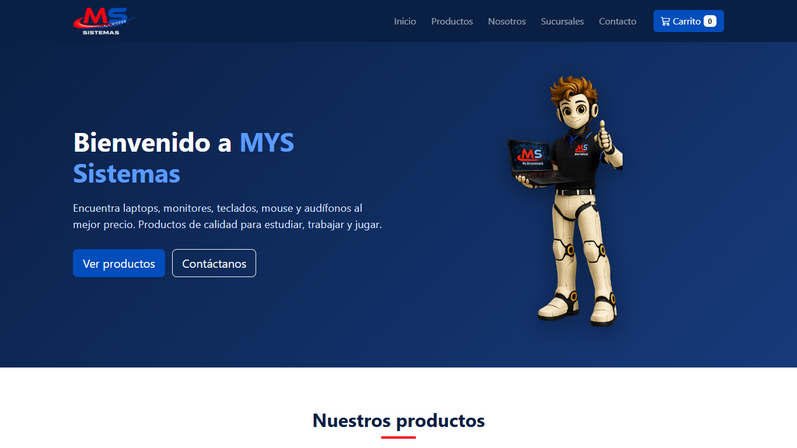

# MYS Sistemas

Página web para **MYS Sistemas**, una tienda de tecnología de Pichari y Kimbiri (Cusco). La hice para el curso de Programación Web de la Universidad Continental.

**Mírala aquí:** https://juniorwilber.github.io/PA01_PROGRAMACION-WEB/

## ¿Qué se puede hacer?

- Ver el catálogo de laptops, monitores, mouse, teclados y audífonos.
- Buscar productos por nombre o filtrarlos por categoría.
- Agregar productos al carrito, ver el total y quitar lo que no quieras. El carrito no se borra al recargar la página.
- Ver las tres sucursales y abrir su ubicación en Google Maps.
- Mandar un mensaje desde el formulario de contacto, que revisa que los datos estén bien.

La compra es de prueba, no se cobra nada.

## ¿Con qué está hecha?

HTML5, CSS3, JavaScript y Bootstrap 5.

## Para abrirla en tu computadora

Descarga el proyecto y abre `index.html` en el navegador. Necesitas internet porque Bootstrap se carga desde un CDN.

---

Hecho por **Wilber Quichua Puelles** · Programación Web · NRC 39409 · Universidad Continental
